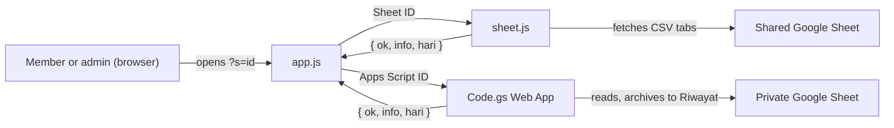

# CLAUDE.md

This file provides guidance to Claude Code (claude.ai/code) when working with code in this repository.

## What this is

Lucky Seat: a static, no-build website that draws a daily seat number for each team member. Data and settings live in a Google Sheet. Deployed to GitHub Pages by GitHub Actions (`.github/workflows/deploy.yml`: on push to `main`, runs `npm test`, then publishes the `public/` folder). See `README.md` (EN, primary) and `docs/README.id.md` (ID) for the user-facing setup.

## Commands

There is no build step or linter. Plain HTML/CSS/vanilla JS. `package.json` exists only for the test script; there are no dependencies.

- Tests: `npm test` (= `node --test`, Node ≥ 18). `tests/draw-parity.test.js` runs `sheet.js` and `apps-script/Code.gs` side by side in `node:vm` with stubbed `fetch` / Apps Script services and a frozen clock. It asserts the two draw implementations return identical results, and that `CODE_GS_API` in `version.js` equals `API_VERSION` in `Code.gs`. Single test: `node --test --test-name-pattern="akhir pekan"`. **Run it after any change to `sheet.js` or `Code.gs`**, and add a scenario to `SKENARIO` when adding a setting.

- Run locally: `npx serve public` or `python -m http.server 5500 -d public` (VS Code Live Server on `public/index.html` also works). Opening `index.html` via `file://` fails on purpose: data fetches are blocked and the app shows a `fileBlocked` error.
- Syntax-check after editing JS: `node --check public/assets/js/app.js` (likewise the other files in `public/assets/js/`).
- Useful URLs: `/?admin` (connect a data source), `/?s=<id>` (invite link; `<id>` is a Sheet ID or an Apps Script deployment ID starting `AKfy`).

## Architecture

**Layout.** `public/` is the website root, exactly what GitHub Pages serves, so the site URL equals `public/`:
- `public/index.html`, `public/guide.html`, and `public/config.js` (the only file admins edit).
- `public/assets/`: `css/style.css`; `js/version.js`, `i18n.js`, `sheet.js`, `app.js` (loaded in that order); `img/icon.svg`.
- `public/apps-script/Code.gs` and `public/templates/{en,id}/` live inside `public/` because `guide.html` offers them as downloads. `Code.gs` is never executed by the site.

Outside `public/` sit only project files: `tests/`, `docs/` (`README.id.md`, `archive/`), `.github/`, and the root meta files. Asset paths used inside JS (e.g. `` in `app.js`) are relative to the **HTML page**, not to the JS file. Short file names below (`app.js`, `sheet.js`, `Code.gs`, …) refer to these locations.

Two interchangeable data sources produce the **same response shape** `{ ok, info, hari }`, and `app.js` only consumes that shape:

- **Option 1: shared Google Sheet** (`sheet.js`, exposes `window.SheetSumber`): fetches the `Anggota`/`Members` and `Pengaturan`/`Settings` tabs as CSV through the gviz endpoint, then computes the draw **in the browser**.
- **Option 2: private sheet via Apps Script** (`apps-script/Code.gs`, deployed separately as a Web App): computes the draw **on the server**. It archives each day's result in a hidden `Riwayat` tab and returns only first names. It is not loaded by the site; users paste it into their own sheet.



`app.js` `panggil(id, tgl)` routes on `scriptId(id)`: Apps Script ID → `fetch …/exec?lang=&tgl=`, otherwise → `SheetSumber.panggilSheet`.

**The draw algorithm is duplicated** in `sheet.js` (`panggilSheet`) and `Code.gs` (`handle`, `hasilHari`, `undi`), together with the helpers `hash`, `shuffle`, `namaDepan`, `aturTetap`, the time-zone helpers and the date-window logic (`aktif`/`berikut`/`buka`). Any change to the draw, settings parsing, error keys or the response shape must be made in **both** files. Key properties:
- Deterministic seeded shuffle `shuffle(pool, "${kunci}|${date}|${n}")`, with up to 60 retries to minimise members getting the same seat as on the previous workday. Results are replayed sequentially from `Tanggal Mulai`, so changing workdays, seat count or fixed seats changes past results in Option 1.
- "Now" is computed in the team's configured time zone (`Zona Waktu`), not the device's, so every phone opens at the same moment.
- Only first names are exposed (`namaDepan` disambiguates duplicates and strips honorifics).

**Settings parsing** accepts both Indonesian and English setting names via an alias map (`ALIAS` in `Code.gs`, equivalent normalisation in `sheet.js` `pengaturan`). Tab lookup always tries the Indonesian name first, then the English one.

**UI (`app.js`)** is one IIFE that renders every screen with `main.innerHTML` template strings: invite-link screen (`butuhLink`), admin setup (`adminSetup`), error (`gagal`), and the main ticket view (`render*`). It also draws JPG share images on a canvas. `main[aria-busy]` keeps the page hidden until the first screen and fonts are ready. On language change, the active screen re-renders through the `ulang` callback.

**i18n + theme (`i18n.js`, exposes `window.I18N`)**: the dictionary `D.id` / `D.en` must keep the **same keys in both** languages. Static text uses `data-i18n` / `data-i18n-aria`; dynamic text uses `t(key, vars)`. The default language is `en`. The user's choice (`localStorage` `ls-lang`) wins over the sheet's `Bahasa`/`Language` setting (`bawaan`). `I18N.toggle()` returns the header controls (theme button + EN|ID switcher) that every screen inserts. Theme state: `html[data-theme]` (explicit choice, `ls-theme`) plus `html[data-theme-now]` (resolved light/dark, used for the icon). `index.html` has a tiny inline head script that applies the saved theme early to avoid a flash.

**`guide.html`** is a bilingual setup guide: both languages sit side by side in the markup (`data-l="id"` / `data-l="en"`) and are toggled by CSS on `html[lang]`. `data-only="sheet|script"` toggles the Option 1 / Option 2 content. Assets in both HTML pages use `?v=<app version>` for cache-busting (see Versioning).

**`style.css`**: all colors are tokens on `:root`. Dark values are defined twice and must stay in sync: under `@media (prefers-color-scheme:dark)` guarded by `:not([data-theme="light"])`, and under `:root[data-theme="dark"]`. Action colors: `--accent` (brand/primary), `--wa` (WhatsApp), `--info` (links), `--danger` (errors). Spacing uses the `--s1…--s7` 4-point scale.

**Versions (`version.js`)** are two separate numbers:
- `window.APP_VERSION` (SemVer string) is the website release. It is shown in the footer of `index.html` and `guide.html`, and used for `?v=` cache-busting.
- `window.CODE_GS_API` (integer) is the Apps Script API version the website needs. It must equal `API_VERSION` in `Code.gs`, which `Code.gs` returns as `info.api`. `app.js` `scriptKuno()` shows a `--warn` notice when a deployed script's `api` is lower. Scripts from v1.0.0–v1.1.x send `versi` instead of `api` and count as API 1; scripts with neither count as 0.
- So admins are asked to redeploy **only** when `Code.gs` changed, never because of a website-only release.

**JPG share images** (`app.js`, canvas) are deliberately always light-themed so they look the same for every WhatsApp recipient. Their hex constants mirror the light tokens in `style.css`.

`docs/archive/lucky-seat.html` is an old standalone prototype, kept for reference only. Don't edit it or link to it.

## Conventions

- Identifiers and code comments are in **Indonesian** (`anggota` = members, `kursi` = seats, `undian` = draw, `tgl` = date, `kunci` = key, `pengaturan` = settings). Keep that style in code.
- File names are English. Templates carry a language suffix: `templates/en/*-EN.csv|tsv`, `templates/id/*-ID.csv|tsv`. Inside an Indonesian sheet the tabs are still named `Anggota` / `Pengaturan`.
- Any user-facing text change needs both `id` and `en` entries (`i18n.js`, `PESAN` in `Code.gs`, `guide.html` `data-l` pairs, `README.md` and `docs/README.id.md`).
- New files go where they belong: anything the site serves → `public/` (code under `public/assets/{css,js,img}`); tests → `tests/`; docs → `docs/`. Keep the repo root for meta files only (README, CHANGELOG, CLAUDE, package.json, dotfiles).
- Header controls (theme button and language switcher) share one 40px height via `.tools { --th }`. Primary buttons and inputs are 48px.
- Every screen ends with the same page footer: `.foot` (divider, then left link = back or main page action with an icon, right link = other destination), then `.ver` with the app version. In `app.js` build it with `kaki(kiri, kanan)` and `tautan(href, icon, text)`; `layar()` adds it by default. Back links use the left-arrow icon and sit on the left. Card actions (copy, download, share) stay in `.links` under the card, never in the footer. Don't show the same destination twice on one screen.
- Internal links to the main page use `./` (e.g. `./?admin`), never `index.html`, so invite links stay `…/lucky-seat/?s=…`.
- Bulk edits on Windows: in PowerShell, `@(@('a','b'))` flattens to `@('a','b')`, so a loop over "pairs" ends up replacing single characters. This previously corrupted `app.js` and `style.css`. Prefer the Edit tool, or build a list with at least two pairs. Run `node --check` and `git diff --stat` after any scripted edit.
- Git author for this repo is the GitHub noreply address (a private email push is rejected by GitHub).

## Versioning

- Follow **Semantic Versioning** `MAJOR.MINOR.PATCH`:
  - **MAJOR**: breaks existing setups. Examples: renamed sheet tabs or setting names, a changed response shape between `Code.gs` and the site, a changed draw algorithm that alters past results, removed URL parameters.
  - **MINOR**: new backward-compatible features (new setting, new screen, new language).
  - **PATCH**: fixes and visual tweaks with no behaviour change for existing users.
- Any change to `Code.gs` that users must redeploy is at least **MINOR**: raise `API_VERSION` in `Code.gs` **and** `CODE_GS_API` in `version.js` by 1 in the same commit, and the release notes must say "Apps Script: create a New version in Manage deployments". A change to `Code.gs` comments or formatting only does not raise `API_VERSION`.
- **Versioning happens only at commit & push time.** Don't bump versions while editing. When the user asks to commit & push:
  1. Pick the bump (MAJOR/MINOR/PATCH) from the highest-impact change since the last tag (`git describe --tags --abbrev=0`; if there is no tag yet, start at `v1.0.0`).
  2. Update the app version in one go, everywhere it appears: `public/assets/js/version.js` (`APP_VERSION`), `package.json`, every `?v=` in `public/index.html` and `public/guide.html`, and `CHANGELOG.md` (rename `[Unreleased]` to `[X.Y.Z] - YYYY-MM-DD` and add a fresh empty `[Unreleased]`). Do **not** touch `API_VERSION` / `CODE_GS_API` here; they change only with a real `Code.gs` change (see above). Then run `npm test`.
  3. Commit (Conventional Commits, see below), then the release commit `chore(release): vX.Y.Z`.
  4. Create an annotated tag `git tag -a vX.Y.Z -m "vX.Y.Z"` and push with the tag: `git push --follow-tags`. The push triggers the Actions workflow (test → deploy).
- While working, add every user-visible change to the `[Unreleased]` section of `CHANGELOG.md` (Keep a Changelog: `Added` / `Changed` / `Fixed` / `Removed`, plus an `Apps Script` note when `Code.gs` changed). It only becomes a version at commit & push time.
- Cache-busting: static asset query strings (`style.css?v=`, scripts) use the app version, so a release refreshes cached copies on members' phones. Exception: `config.js` has no `?v=`, because admins edit it outside the release cycle.

## Commit messages

- Use **Conventional Commits**, in English: `type(scope): summary`
  - Types: `feat`, `fix`, `style` (visual/CSS only), `refactor`, `docs`, `chore`, `perf`.
  - Scopes: `ui`, `admin`, `guide`, `i18n`, `theme`, `sheet`, `apps-script`, `templates`, `readme`, `ci`, `tests`.
  - Summary: imperative mood, lowercase, no trailing period, ≤ 72 characters. Example: `feat(theme): add manual light/dark toggle`.
- The body explains **why** and any user action needed (redeploy Apps Script, re-import a template). Wrap at 72 characters.
- Breaking changes: add `!` after the type (`feat(sheet)!: …`) plus a `BREAKING CHANGE:` footer describing the migration.
- One logical change per commit. Don't mix a rename with a behaviour change: renames first, so git keeps the file history.
- Never commit `.claude/` or local secrets (see `.gitignore`).

## Writing style (no AI slop)

Applies to every piece of text in this repo: UI copy (`i18n.js`, `guide.html`, `PESAN` in `Code.gs`), READMEs, CHANGELOG, code comments, commit messages, and the WhatsApp message templates. Both languages.

**Punctuation**
- No em dashes (`—`) and no en dashes used as dashes (`–`). Use a period, comma, colon, or parentheses instead. En dashes are fine only in number ranges (`1–2 minutes`).
- No ellipsis (`…`) for suspense or trailing off. It's OK only as a placeholder in a URL pattern (`…/exec`).
- No exclamation marks in UI copy. At most one per README, and only where something genuinely finishes ("Done!").
- Straight quotes in code; in prose, be consistent within a file.

**Words to avoid** (they add hype, not meaning)
- EN: seamless(ly), effortless(ly), robust, leverage, utilize, delve, empower, elevate, unlock, streamline, cutting-edge, game-changer, powerful, simply, just, easily, very, really, truly, "it's worth noting", "in today's world", "whether you're … or …".
- ID: *sangat*, *tentunya*, *dengan mudah*, *secara efektif*, *solusi*, *inovatif*, *canggih*, *optimal*, *maksimal*, *memberdayakan*, *hadir untuk*, *tidak hanya … tetapi juga …*.
- Replace them with the concrete fact: "opens at 07:00", "takes about 5 minutes", "no sign-in needed".

**Structure**
- Lead with what the reader does or gets. Verb first for buttons and steps ("Copy link", "Salin link"), not "Click here to…".
- One idea per sentence. UI strings: ideally ≤ 12 words; error messages say what happened, then the fix ("Seats: 20, members: 24. Increase Seats.").
- No forced groups of three, no "X, not just Y" contrasts, no rhetorical questions, no closing summary that repeats the paragraph above.
- Sentence case for headings and buttons ("Draw number", not "Draw Number"). Product and UI names keep their real spelling (Google Sheet, Apps Script, WhatsApp).
- Emoji: none in the app UI or error messages. README may use one per feature/table row as a visual marker, never inside sentences.

**Voice**
- Address the reader as "you" (EN) / "kamu" (ID, informal, as the app already does). Don't mix "Anda" and "kamu".
- Plain words a first-time admin understands. Explain a technical term the first time it appears, or avoid it.
- Don't oversell. No promises the code doesn't keep (e.g. say "can't be re-rolled from a member's phone", not "100% tamper-proof").

**Diagrams**
- Any diagram (flow, architecture, sequence, state, timeline) in Markdown is a fenced ` ```mermaid ` block, never ASCII art or an image. GitHub renders Mermaid natively.
- Folder trees are the one exception: keep them as a plain ` ``` ` text tree.
- Keep diagrams small (≤ ~10 nodes), label every arrow with a short verb ("reads", "shares link"), and follow the same no-slop rules for labels. Use plain node shapes and no custom colors or `style`/`classDef`, so they render well in both GitHub light and dark themes.
- Label text with special characters (`/`, `(`, `?`, `:`) goes in quotes: `A["Google Sheet (names)"]`.

**Before finishing any text change**, search the touched files for `—` and for the words above, and rewrite what you find. Keep EN and ID meaning identical; translate the meaning, not word for word.

## Colors

- Use **tokens only**. Hex values live in the `:root` token blocks of `style.css`; components use `var(--…)`. A new color means a new token, defined for light **and** both dark blocks.
- Colors carry **meaning by action**, consistently across screens:

  | Token | Role |
  |---|---|
  | `--accent` | Brand and the primary action of a screen (one primary per screen) |
  | `--wa` | WhatsApp-related actions only |
  | `--info` | Links, navigation, focus on link inputs |
  | `--danger` | Errors and destructive actions, never decoration |
  | `--warn` | Needs attention but not broken (e.g. outdated Apps Script) |
  | `--ink` / `--mute` | Main text / secondary text and icons |
  | `--on-color` | Text and icons on a colored background (`--accent`, `--wa`) |
  | `--line`, `--field`, `--surface`, `--paper` | Borders, inputs, cards, page background |

- Tints for backgrounds and icon tiles use `color-mix(in srgb, var(--token) N%, var(--surface))` (≈8–10% fill, ≈28–40% border) instead of new hex values, so they adapt to both themes.
- Contrast: body text and button labels must meet **WCAG AA** (4.5:1; 3:1 for large text and icons) in **both** themes. Never use color as the only signal: pair errors with text, and active states with `aria-pressed` / shape.
- The canvas JPG images in `app.js` (always light, by design) and `icon.svg` don't read CSS tokens. Keep their colors in sync with the light tokens by hand.
