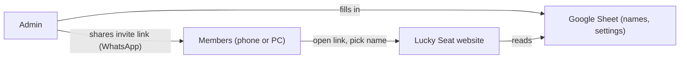

<p align="center">
  
</p>

<h1 align="center">Lucky Seat</h1>

<p align="center"><b>English</b> · <a href="docs/README.id.md">Bahasa Indonesia</a></p>

<p align="center">
  Fair, automatic daily seat draws for your team, shared with a single WhatsApp link.
</p>

<p align="center">
  
  
  
  
  <a href="LICENSE"></a>
</p>

---

## Table of contents

- [What is Lucky Seat?](#what-is-lucky-seat)
- [Features](#features)
- [How it works](#how-it-works)
- [Getting started (for admins)](#getting-started-for-admins)
- [Sheet settings](#sheet-settings)
- [How to use it (for members)](#how-to-use-it-for-members)
- [Running it yourself](#running-it-yourself)
- [Folder structure](#folder-structure)
- [Troubleshooting](#troubleshooting)
- [FAQ](#faq)
- [License](#license)

---

## What is Lucky Seat?

**Lucky Seat** is a small website that randomly assigns seat numbers every workday.
It suits hot-desk offices, classrooms, or any team that rotates where people sit.

- **Admins** set up one Google Sheet with the member names and settings.
- **Members** open a link, pick their name, and see today's seat number.

No app to install, no accounts, and no server of your own.

## Features

| Feature | Description |
|---|---|
| 🎲 Fair draw | Random but reproducible: everyone who opens the link sees the same result. |
| 🔁 No repeats | Where possible, nobody gets the same seat as on the previous workday. |
| ⏰ Draw time | Seat numbers open at a set time, in your team's time zone. |
| 📌 Fixed seats | Give specific members a fixed seat that isn't part of the draw. |
| 💬 Share to WhatsApp | Send the seat list or a personal card to the group in one click. |
| 🖼️ Save as image | Download the seat list as a JPG. |
| 🌐 Two languages | English (default) and Indonesian, switchable anytime. |
| 🌗 Light & dark theme | Follows the device setting, or pick one yourself. |
| 📱 Mobile-friendly | Designed for small screens. |

## How it works



1. The admin fills in names and settings in a **Google Sheet**.
2. The Lucky Seat website reads that sheet and calculates today's draw.
3. The admin shares the **invite link** (ending in `?s=...`) in the WhatsApp group.
4. Members open the link, pick their name, and see their seat number.

## Getting started (for admins)

> 💡 A step-by-step illustrated guide is also available at **`guide.html`** once the site is online.

There are **two ways** to connect your data. Pick one:

| | Option 1 · Google Sheet | Option 2 · Apps Script |
|---|---|---|
| Time | ~5 minutes | ~10 minutes |
| Difficulty | Easiest | Slightly more technical |
| Privacy | Anyone with the sheet link can see the names | The sheet stays private, never shared |
| Best for | Small teams, non-sensitive data | When you want the data better protected |

### Step 1: Download the templates

Get the files from the [`templates/`](public/templates/) folder:

| File | Contents |
|---|---|
| [`templates/en/Members-EN.csv`](public/templates/en/Members-EN.csv) | Member names |
| [`templates/en/Settings-EN.csv`](public/templates/en/Settings-EN.csv) | Time, dates, number of seats, etc. |
| [`apps-script/Code.gs`](public/apps-script/Code.gs) | **Option 2** only |

Indonesian versions (`-ID`) are in [`templates/id/`](public/templates/id/).

### Step 2: Set up the Google Sheet

1. Open [sheets.new](https://sheets.new) and name the spreadsheet.
2. Rename the `Sheet1` tab to **`Members`**.
   Then **File → Import → Upload**, choose `Members-EN.csv`, and pick **Replace current sheet**.
3. Replace the sample names with your team, **one name per row**.
4. Add a new tab named **`Settings`** and import `Settings-EN.csv` the same way.
5. In column B, fill in at least:
   - **Start Date**: e.g. `'2026-11-16` (with an apostrophe `'` in front)
   - **Seats**: at least the number of members
   - **Key**: any random text, **keep it secret**

> ⚠️ Tab names must be exactly **`Members`** and **`Settings`** (or **`Anggota`** and **`Pengaturan`** for the Indonesian templates).

### Step 3: Connect

<details>
<summary><b>Option 1 · Google Sheet</b> (click to expand)</summary>

1. In Google Sheets, click **Share** → **General access**: **Anyone with the link** as **Viewer**.
2. Click **Copy link**.
3. Open the Lucky Seat website with `?admin` at the end (e.g. `https://your-name.github.io/lucky-seat/?admin`).
4. Choose **Google Sheet**, paste the link, and click **Test & connect**.
5. You see **"Invite link ready"**.

</details>

<details>
<summary><b>Option 2 · Apps Script</b> (click to expand)</summary>

1. In Google Sheets, click **Extensions → Apps Script**.
2. Delete all the code, paste the contents of [`Code.gs`](public/apps-script/Code.gs), then save (<kbd>Ctrl</kbd> + <kbd>S</kbd>).
3. Click **Deploy → New deployment** → type **Web app**.
   - Execute as: **Me**
   - Who has access: **Anyone**
4. Click **Deploy**, then authorize access.
   If you see *"Google hasn't verified this app"*, click **Advanced → Go to (unsafe)**. That's normal for your own script.
5. Copy the URL ending in **`/exec`**.
6. Open the Lucky Seat website with `?admin` at the end, choose **Apps Script**, paste the URL, and click **Test & connect**.
7. You see **"Invite link ready"**.

</details>

### Step 4: Share with members

Click **Send to WhatsApp group** or **Copy link**. Done!

You can change the settings in the sheet anytime. **The invite link stays the same.**

## Sheet settings

All settings live in the **`Settings`** tab, column B:

| Setting | Example | What it does | Safe to change? |
|---|---|---|---|
| **Title** | `Lucky Seat` | Title on the page and images | ✅ Anytime |
| **Subtitle** | `Design Team` | Team name, shown under the title | ✅ Anytime |
| **Language** | `English` | Default language: `English` or `Indonesia` | ✅ Anytime |
| **Start Date** | `'2026-11-09` | First draw day. **Required** | ⛔ Not after it starts |
| **Workdays** | `Monday, Tuesday, Wednesday, Thursday, Friday` | Draw days, comma-separated | ⚠️ Changes all results* |
| **Draw Time** | `07:00` | When seat numbers open | ✅ Anytime |
| **Time Zone** | `Asia/Jakarta` | e.g. `Asia/Jakarta`, `Europe/London`, or `+7` | ✅ Anytime |
| **Seats** | `24` | At least the number of members | ⚠️ Changes all results* |
| **Draw Mode** | `Manual` | `Manual` = press a button, `Automatic` = shown right at draw time | ✅ Anytime |
| **Fixed Seats** | `Vina: 3, Budi: 7` | Members left out of the draw | ⚠️ Changes all results* |
| **Key** | `MyTeam-x8Qp2` | Secret text for the shuffle (Option 1 only) | ⛔ Not after it starts |

\* Option 1 only: results are recalculated from the settings, so past days change too.
The exact setting names are in the `Settings-EN.csv` template, with a description next to each one.

## How to use it (for members)

1. Open the **invite link** from your admin in the WhatsApp group.
2. Pick **your name** from the list.
3. Press **Draw number** (or the number shows right away if the admin chose *Automatic* mode).
4. Check where your seat is on the mini map, and share your card if you like.

> 💡 Save the invite link (for example, add it to your phone's home screen) so it's easy to open every day.

## Running it yourself

The site is plain HTML, CSS, and JavaScript in the **`public/`** folder. There is **no build step**.

> ⚠️ Don't open `index.html` by double-clicking it (a `file://` address). The browser will block the data requests. Use a local server.

**Option A: Node.js**

```bash
npx serve public
```

**Option B: Python**

```bash
python -m http.server 5500 -d public
```

**Option C: VS Code.** install the **Live Server** extension, right-click `public/index.html` → **Open with Live Server**.

Then open `http://localhost:5500` (or the address shown).

**Run the tests** (Node.js 18+, no install needed):

```bash
npm test
```

This checks that Option 1 (`sheet.js`) and Option 2 (`Code.gs`) always produce the same draw.

### Publish for free with GitHub Pages

1. Push this repository to GitHub.
2. Go to **Settings → Pages** and set **Source** to **GitHub Actions** (one time only).
3. Every push to `main` now runs the tests and, if they pass, publishes the `public/` folder automatically ([`.github/workflows/deploy.yml`](.github/workflows/deploy.yml)).
4. Follow progress in the **Actions** tab. The site is live at `https://<username>.github.io/<repo-name>/`.

### (Optional) A link without `?s=`

Fill in [`config.js`](public/config.js) so the site's main address connects straight to your team's data:

```js
window.CONFIG = {
  api: "https://docs.google.com/spreadsheets/d/xxxxx/edit"  // or the Apps Script URL .../exec
};
```

## Folder structure

```
lucky-seat/
├── public/                     # ← The website (everything GitHub Pages serves)
│   ├── index.html              # Main page (members & admin)
│   ├── guide.html              # Illustrated setup guide
│   ├── config.js               # (Optional) default data link, the only file admins edit
│   ├── assets/
│   │   ├── css/style.css       # Styles (light/dark theme tokens)
│   │   ├── js/
│   │   │   ├── version.js      # App version (shown in the footer)
│   │   │   ├── i18n.js         # Two-language text + theme toggle
│   │   │   ├── sheet.js        # Option 1: reads Google Sheets, draws in the browser
│   │   │   └── app.js          # Screens, rendering, sharing
│   │   └── img/icon.svg        # Site icon
│   ├── apps-script/Code.gs     # Option 2: server-side draw (downloaded & pasted into your sheet)
│   └── templates/{en,id}/      # Sheet templates (*-EN / *-ID)
├── tests/                      # Checks that both options give the same draw
├── docs/
│   ├── README.id.md            # Indonesian README
│   └── archive/                # Old prototype, for reference only
├── .github/workflows/          # Test & deploy to GitHub Pages
├── CHANGELOG.md                # What changed in each version
├── CLAUDE.md                   # Notes for AI coding assistants
├── README.md
└── package.json                # Test script only (no dependencies)
```

## Troubleshooting

| Problem | Fix |
|---|---|
| **"The Google Sheet can't be read yet"** | Make sure access is **Anyone with the link · Viewer**, and the tabs are named exactly `Members` and `Settings`. |
| **Date is empty or a strange number** | Retype it with an apostrophe in front: `'2026-11-16`. |
| **"Too few seats" message** | Increase **Seats**. |
| **Apps Script returns no data** | Access must be **Anyone** and the URL must end in `/exec`. |
| **Edited `Code.gs` but nothing changed** | **Manage deployments** → pencil icon → **New version** → **Deploy**. |
| **CSV import failed** | Download `Settings-paste-EN.tsv`, open it in Notepad, copy everything, and paste into cell A1. |
| **Blank page when opened from a file** | Run it through a local server or GitHub Pages (see above). |

## FAQ

**Is my data stored on someone else's server?**
No. All data stays in your own Google Sheet. The website only reads it.

**Do members need to sign in?**
No. They open the invite link and pick their name.

**What if someone new joins?**
Add their name to the `Members` tab. The invite link stays the same.

**Can the draw be rigged?**
Results are calculated from the secret **Key** and the date, so they're the same for everyone who opens the link and can't be re-rolled from a member's phone.

## License

[MIT](LICENSE) © 2026 Romadhon. You may use, change and share this project, including for work or commercial use, as long as you keep the copyright notice and the license text.

---

<p align="center">Made for teams who share seats.</p>
