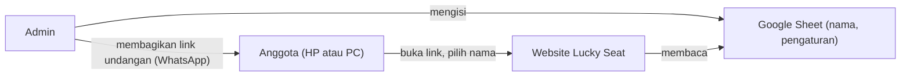

<p align="center">
  
</p>

<h1 align="center">Lucky Seat</h1>

<p align="center"><a href="../README.md">English</a> · <b>Bahasa Indonesia</b></p>

<p align="center"><a href="https://karsawave.github.io/lucky-seat/"><b>Coba langsung</b></a> · <a href="https://karsawave.github.io/lucky-seat/guide.html">Panduan pemasangan</a></p>

<p align="center">
  Undian nomor kursi harian untuk tim kerja, adil, otomatis, dan cukup dibagikan lewat satu link WhatsApp.
</p>

<p align="center">
  
  
  
  
  <a href="../LICENSE"></a>
</p>

---

## Daftar isi

- [Apa itu Lucky Seat?](#apa-itu-lucky-seat)
- [Fitur](#fitur)
- [Cara kerja singkat](#cara-kerja-singkat)
- [Memulai (untuk admin)](#memulai-untuk-admin)
- [Pengaturan di Google Sheet](#pengaturan-di-google-sheet)
- [Cara pakai (untuk anggota)](#cara-pakai-untuk-anggota)
- [Menjalankan di komputer sendiri](#menjalankan-di-komputer-sendiri)
- [Struktur folder](#struktur-folder)
- [Kalau ada masalah](#kalau-ada-masalah)
- [FAQ](#faq)
- [Lisensi](#lisensi)

---

## Apa itu Lucky Seat?

**Lucky Seat** adalah website kecil untuk membagi nomor kursi secara acak setiap hari kerja.
Cocok untuk kantor dengan sistem *hot desk*, ruang kelas, atau tim yang bergantian tempat duduk.

- **Admin** cukup menyiapkan satu Google Sheet berisi daftar nama dan pengaturan.
- **Anggota** cukup membuka link, memilih nama, lalu melihat nomor kursinya hari itu.

Tidak perlu install aplikasi, tidak perlu akun, dan tidak perlu server sendiri.

## Fitur

| Fitur | Keterangan |
|---|---|
| 🎲 Undian adil | Hasil acak tetapi bisa diperiksa ulang (sama untuk semua orang yang membuka). |
| 🔁 Tidak mengulang | Sebisa mungkin tidak ada yang dapat kursi sama dengan hari kerja sebelumnya. |
| ⏰ Jam undian | Nomor dibuka otomatis pada jam tertentu, sesuai zona waktu tim. |
| 📌 Kursi tetap | Anggota tertentu bisa diberi kursi tetap (tidak ikut diacak). |
| 💬 Bagikan ke WhatsApp | Kirim daftar kursi atau kartu pribadi ke grup dengan satu klik. |
| 🖼️ Simpan gambar | Unduh daftar kursi sebagai gambar JPG. |
| 🌐 Dua bahasa | English (bawaan) dan Indonesia, bisa diganti kapan saja. |
| 🌗 Tema terang & gelap | Ikut pengaturan HP/laptop, atau pilih sendiri. |
| 📱 Ramah HP | Tampilan dirancang untuk layar kecil. |

## Cara kerja singkat



1. Admin mengisi daftar nama dan pengaturan di **Google Sheet**.
2. Website Lucky Seat membaca sheet tersebut dan menghitung undian hari ini.
3. Admin membagikan **link undangan** (berakhiran `?s=...`) ke grup WhatsApp.
4. Anggota membuka link, memilih nama, dan melihat nomor kursinya.

## Memulai (untuk admin)

> 💡 Panduan bergambar yang lebih lengkap juga tersedia di halaman **`guide.html`** setelah website online.

Ada **dua cara** menghubungkan data. Pilih salah satu:

| | Opsi 1 · Google Sheet | Opsi 2 · Apps Script |
|---|---|---|
| Waktu | ± 5 menit | ± 10 menit |
| Tingkat kesulitan | Paling mudah | Sedikit lebih teknis |
| Privasi | Siapa pun yang punya link sheet bisa melihat daftar nama | Sheet tetap privat, tidak dibagikan |
| Cocok untuk | Tim kecil, data tidak sensitif | Data ingin lebih dijaga |

### Langkah 1: Unduh template

Ambil berkas dari folder [`templates/`](../public/templates/):

| Berkas | Isi |
|---|---|
| [`templates/id/Members-ID.csv`](../public/templates/id/Members-ID.csv) | Daftar nama anggota |
| [`templates/id/Settings-ID.csv`](../public/templates/id/Settings-ID.csv) | Jam, tanggal, jumlah kursi, dll. |
| [`apps-script/Code.gs`](../public/apps-script/Code.gs) | Hanya untuk **Opsi 2** |

Versi bahasa Inggris (`-EN`) ada di [`templates/en/`](../public/templates/en/).

### Langkah 2: Siapkan Google Sheet

1. Buka [sheets.new](https://sheets.new) dan beri nama spreadsheet.
2. Ganti nama tab `Sheet1` menjadi **`Anggota`**.
   Lalu **File → Impor → Upload**, pilih `Members-ID.csv`, pilih **Ganti sheet saat ini**.
3. Ganti nama contoh dengan nama anggota tim, **satu nama per baris**.
4. Tambah tab baru bernama **`Pengaturan`**, lalu impor `Settings-ID.csv` dengan cara yang sama.
5. Di kolom B, isi minimal:
   - **Tanggal Mulai**: contoh `'2026-11-16` (pakai tanda petik `'` di depan)
   - **Jumlah Kursi**: minimal sama dengan jumlah anggota
   - **Kunci**: teks acak bebas, **rahasiakan**

> ⚠️ Nama tab harus persis **`Anggota`** dan **`Pengaturan`** (atau **`Members`** dan **`Settings`** untuk template bahasa Inggris).

### Langkah 3: Hubungkan

<details>
<summary><b>Opsi 1 · Google Sheet</b> (klik untuk membuka)</summary>

1. Di Google Sheet, klik **Bagikan** → **Akses umum**: **Siapa saja yang memiliki link** sebagai **Pelihat**.
2. Klik **Salin link**.
3. Buka website Lucky Seat dengan akhiran `?admin` (contoh: `https://karsawave.github.io/lucky-seat/?admin`, atau salinan milikmu sendiri).
4. Pilih **Google Sheet**, tempel link, klik **Uji & hubungkan**.
5. Muncul tulisan **"Link undangan siap"**.

</details>

<details>
<summary><b>Opsi 2 · Apps Script</b> (klik untuk membuka)</summary>

1. Di Google Sheet, klik **Ekstensi → Apps Script**.
2. Hapus semua kode, tempel isi [`Code.gs`](../public/apps-script/Code.gs), lalu simpan (<kbd>Ctrl</kbd> + <kbd>S</kbd>).
3. Klik **Terapkan → Deployment baru** → jenis **Aplikasi web**.
   - Jalankan sebagai: **Saya**
   - Yang memiliki akses: **Siapa saja**
4. Klik **Terapkan**, lalu izinkan akses.
   Jika muncul *"Google belum memverifikasi aplikasi ini"*, klik **Lanjutan → Buka (tidak aman)**. Ini normal untuk skrip milik sendiri.
5. Salin URL yang berakhiran **`/exec`**.
6. Buka website Lucky Seat dengan akhiran `?admin`, pilih **Apps Script**, tempel URL, klik **Uji & hubungkan**.
7. Muncul tulisan **"Link undangan siap"**.

</details>

### Langkah 4: Bagikan ke anggota

Klik **Kirim ke grup WhatsApp** atau **Salin link**. Selesai!

Pengaturan bisa diubah kapan saja di sheet. **Link undangan tidak berubah.**

## Pengaturan di Google Sheet

Semua pengaturan ada di tab **`Pengaturan`**, kolom B:

| Pengaturan | Contoh | Penjelasan | Boleh diubah? |
|---|---|---|---|
| **Judul** | `Lucky Seat` | Judul di halaman dan gambar | ✅ Kapan saja |
| **Subjudul** | `Tim Desain` | Nama tim, tampil di bawah judul | ✅ Kapan saja |
| **Bahasa** | `Indonesia` | Bahasa bawaan: `English` (bawaan) atau `Indonesia` | ✅ Kapan saja |
| **Tanggal Mulai** | `'2026-11-09` | Hari undian pertama. **Wajib** | ⛔ Jangan setelah berjalan |
| **Hari Kerja** | `Senin, Selasa, Rabu, Kamis, Jumat` | Hari ada undian, pisahkan dengan koma | ⚠️ Mengubah semua hasil* |
| **Jam Undian** | `07:00` | Jam nomor kursi dibuka | ✅ Kapan saja |
| **Zona Waktu** | `Asia/Jakarta` | WIB, `Asia/Makassar` (WITA), `Asia/Jayapura` (WIT), atau `+7` | ✅ Kapan saja |
| **Jumlah Kursi** | `24` | Minimal sama dengan jumlah anggota | ⚠️ Mengubah semua hasil* |
| **Cara Ambil** | `Manual` | `Manual` = tekan tombol, `Otomatis` = langsung tampil | ✅ Kapan saja |
| **Kursi Tetap** | `Vina: 3, Budi: 7` | Anggota yang tidak ikut diacak | ⚠️ Mengubah semua hasil* |
| **Kunci** | `TimKu-x8Qp2` | Teks rahasia pengacak (Opsi 1 saja) | ⛔ Jangan setelah berjalan |

\* Khusus Opsi 1: hasil undian dihitung ulang dari pengaturan, jadi hasil hari-hari sebelumnya ikut berubah.

## Cara pakai (untuk anggota)

1. Buka **link undangan** dari admin di grup WhatsApp.
2. Pilih **nama kamu** di daftar.
3. Tekan **Ambil nomor** (atau nomor langsung tampil jika admin memilih mode *Otomatis*).
4. Lihat posisi kursi di peta kecil, dan bagikan kartumu bila perlu.

> 💡 Simpan link undangan (misalnya tambahkan ke layar utama HP) supaya mudah dibuka setiap hari.

## Menjalankan di komputer sendiri

Website ini hanya terdiri dari file HTML, CSS, dan JavaScript biasa di folder **`public/`**. **Tidak perlu build.**

> ⚠️ Jangan membuka `index.html` dengan klik dua kali (alamat `file://`). Browser akan memblokir pengambilan data. Gunakan server lokal.

**Cara 1: Node.js**

```bash
npx serve public
```

**Cara 2: Python**

```bash
python -m http.server 5500 -d public
```

**Cara 3: VS Code.** pasang ekstensi **Live Server**, klik kanan `public/index.html` → **Open with Live Server**.

Lalu buka `http://localhost:5500` (atau alamat yang ditampilkan).

**Menjalankan tes** (Node.js 18+, tanpa instal apa pun):

```bash
npm test
```

Tes ini memastikan Opsi 1 (`sheet.js`) dan Opsi 2 (`Code.gs`) selalu menghasilkan undian yang sama.

### Publikasi gratis dengan GitHub Pages

1. *Push* repository ini ke GitHub.
2. Buka **Settings → Pages**, lalu ubah **Source** menjadi **GitHub Actions** (cukup sekali).
3. Setiap *push* ke `main` otomatis menjalankan tes dan, bila lolos, menerbitkan folder `public/` ([`.github/workflows/deploy.yml`](../.github/workflows/deploy.yml)).
4. Pantau prosesnya di tab **Actions**. Website tersedia di `https://<username>.github.io/<nama-repo>/`.

### (Opsional) Link tanpa `?s=`

Isi [`config.js`](../public/config.js) agar alamat utama website langsung terhubung ke data tim:

```js
window.CONFIG = {
  api: "https://docs.google.com/spreadsheets/d/xxxxx/edit"  // atau URL Apps Script .../exec
};
```

## Struktur folder

```
lucky-seat/
├── public/                     # ← Website (semua yang diterbitkan GitHub Pages)
│   ├── index.html              # Halaman utama (anggota & admin)
│   ├── guide.html              # Panduan pemasangan bergambar
│   ├── config.js               # (Opsional) link data bawaan, satu-satunya file yang diubah admin
│   ├── assets/
│   │   ├── css/style.css       # Tampilan (token warna tema terang/gelap)
│   │   ├── js/
│   │   │   ├── version.js      # Versi aplikasi (tampil di kaki halaman)
│   │   │   ├── i18n.js         # Teks dua bahasa + tombol tema
│   │   │   ├── sheet.js        # Opsi 1: membaca Google Sheet, mengundi di browser
│   │   │   └── app.js          # Layar, tampilan, berbagi
│   │   └── img/icon.svg        # Ikon website
│   ├── apps-script/Code.gs     # Opsi 2: undian di server (diunduh & ditempel ke sheet kamu)
│   └── templates/{en,id}/      # Template sheet (*-EN / *-ID)
├── tests/                      # Memastikan kedua opsi memberi hasil undian yang sama
├── docs/
│   ├── README.id.md            # README bahasa Indonesia (file ini)
│   └── archive/                # Prototipe lama, hanya untuk referensi
├── .github/workflows/          # Tes & terbitkan ke GitHub Pages
├── CHANGELOG.md                # Catatan perubahan tiap versi
├── CLAUDE.md                   # Catatan untuk asisten AI
├── README.md
└── package.json                # Hanya skrip tes (tanpa dependensi)
```

## Kalau ada masalah

| Masalah | Cara memperbaiki |
|---|---|
| **"Google Sheet belum bisa dibaca"** | Pastikan akses **Siapa saja yang memiliki link · Pelihat**, dan nama tab persis `Anggota` dan `Pengaturan`. |
| **Tanggal kosong atau berubah jadi angka aneh** | Ketik ulang dengan petik di depan: `'2026-11-16`. |
| **"Anggota … orang, kursi hanya …"** | Perbesar **Jumlah Kursi**. |
| **Apps Script tidak memberi data** | Akses harus **Siapa saja** dan URL berakhiran `/exec`. |
| **Mengubah `Code.gs` tetapi tidak berefek** | **Kelola deployment** → ikon pensil → **Versi baru** → **Terapkan**. |
| **Impor CSV gagal** | Unduh `Settings-paste-ID.tsv`, buka di Notepad, salin semua, tempel di sel A1. |
| **Halaman kosong saat dibuka dari file** | Jalankan lewat server lokal atau GitHub Pages (lihat di atas). |

## FAQ

**Apakah data saya disimpan di server lain?**
Tidak. Semua data tetap di Google Sheet milikmu. Website hanya membacanya.

**Apakah anggota perlu login?**
Tidak. Cukup buka link undangan dan pilih nama.

**Bagaimana jika ada anggota baru?**
Tambahkan nama di tab `Anggota`. Link undangan tetap sama.

**Apakah hasil undian bisa dicurangi?**
Hasil dihitung dari **Kunci** rahasia dan tanggal, sehingga sama untuk semua orang yang membuka dan tidak bisa diatur ulang dari HP anggota.

## Lisensi

[MIT](../LICENSE) © 2026 [Karsa Wave](https://github.com/karsawave). Kamu boleh memakai, mengubah, dan membagikan proyek ini, termasuk untuk kantor atau komersial, asalkan tetap menyertakan pemberitahuan hak cipta dan teks lisensinya.

---

<p align="center">Dibuat untuk tim yang berbagi tempat duduk.</p>
