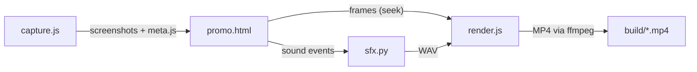

# Promo video

Sources for the Lucky Seat promo video. Every version renders from one template (`promo.html`), using real screens captured from the site in `public/`.

| Version | Use it for |
|---|---|
| `id` / `en`, `9x16`, 25 s | WhatsApp Status, Instagram Reels, TikTok |
| `9x16`, 15 s | Short ads |
| `16x9`, 25 s | LinkedIn, YouTube, presentations (ends with a QR code to the site) |

In the vertical versions, titles start at 270px from the top and keep 150px clear on the right, so the Reels/TikTok buttons don't cover them.

## How it is made



- `capture.js` opens the site from `public/` at 412px wide (6× pixel density) with the Indonesian templates, and freezes the clock at 10 Nov 2026 08:15 WIB, so every capture shows the same draw and timer. It saves the ticket states, the 15 rolling frames, and the real JPG from "Save list as JPG".
- `promo.html` is the timeline. Options in the URL: `lang=id|en`, `ratio=9x16|16x9`, `cut=25|15`, `cover=1`.
- `sfx.py` builds the sound from the timeline: a 120 BPM beat, ticks while the number rolls, taps, and a ding when it stops. It is all synthesized, so there are no music rights to clear.
- `render.js` sends each frame as PNG straight to ffmpeg (H.264, 60 fps, CRF 14, AAC 256 kbps).

## Render

You need Node ≥ 18 with Playwright and Chromium, ffmpeg, and python3. All output goes to `build/`, which git ignores.

1. Fonts (once):

   ```bash
   mkdir -p docs/promo/build/fonts && cd docs/promo/build/fonts
   curl -sS -A "Mozilla/5.0 Chrome/120" "https://fonts.googleapis.com/css2?family=Bricolage+Grotesque:wght@500;800&family=JetBrains+Mono:wght@500;700&display=swap" -o f.css
   i=0; for u in $(grep -o "https://[^)]*" f.css | sort -u); do i=$((i+1)); curl -sS "$u" -o f$i.woff2; sed -i "s#$u#f$i.woff2#g" f.css; done
   ```

2. Capture the screens (again after any UI change):

   ```bash
   node docs/promo/capture.js id
   ```

   ```bash
   node docs/promo/capture.js en
   ```

3. Render:

   ```bash
   node docs/promo/render.js --lang id --ratio 9x16 --cut 25
   ```

   ```bash
   node docs/promo/render.js --lang en --ratio 16x9 --cut 25
   ```

   ```bash
   node docs/promo/render.js --lang id --ratio 9x16 --still 2
   ```

   `--still 2` renders the cover image. `--preview 2,9.5,20` renders a few PNGs to check before a full render, which takes about 2–3 minutes.

`qr.svg` points to `https://karsawave.github.io/lucky-seat/`.

Publish finished videos in GitHub Releases, not in the repo: they run to several MB each.

---

**Bahasa Indonesia, singkat:** semua versi video dibuat dari `promo.html`. Jalankan `capture.js id` atau `capture.js en` untuk mengambil layar asli, lalu `render.js` dengan `--lang`, `--ratio` dan `--cut`. Hasilnya ada di `build/` dan tidak masuk git.
